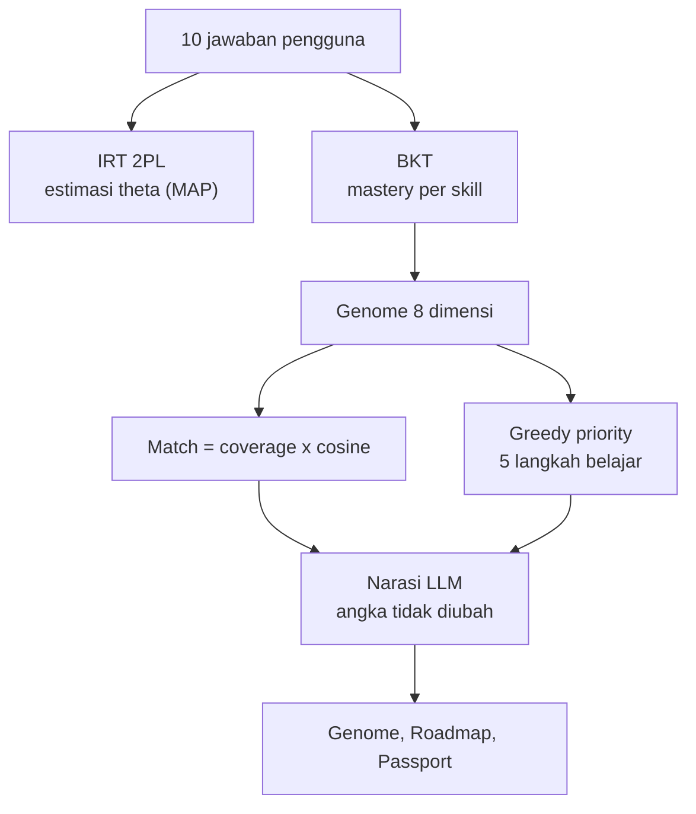
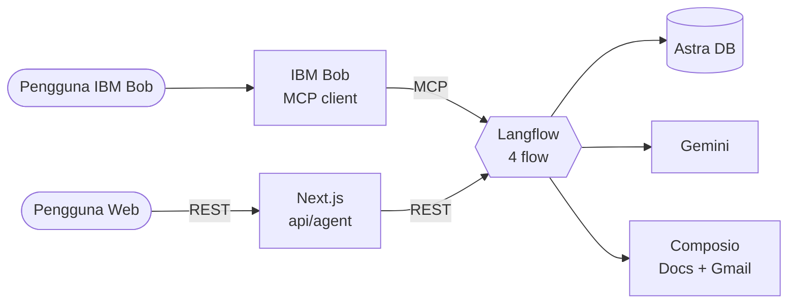
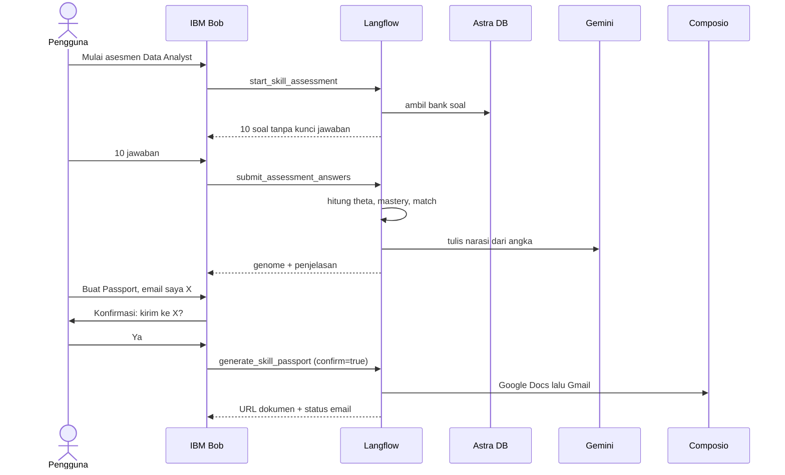

<div align="center">

# SkillGenome

**Your skill DNA, decoded.**

Asesmen adaptif 10 soal yang memetakan penguasaan 8 skill menjadi *genome*, menyusun 5 langkah belajar prioritas, dan membuat Skill Passport otomatis lewat AI agent.


[**Coba demo**](https://YOUR-APP.vercel.app) ·
[Cara kerja](#cara-kerja) ·
[Arsitektur](#arsitektur) ·
[Algoritma](#algoritma) ·
[Setup cepat](#setup-cepat) ·
[Responsible AI](#responsible-ai) ·
[Dokumentasi](#dokumentasi)

</div>

---

> **Ringkasan 30 detik untuk reviewer**
>
> - **Masalah:** calon Data Analyst tidak tahu skill mana yang benar-benar sudah dikuasai, sehingga belajar tanpa arah.
> - **Solusi:** 10 soal adaptif (IRT + BKT) → genome 8 skill → 5 langkah belajar → Skill Passport (Google Docs + email) yang dibuat agent.
> - **Integrasi wajib:** **Langflow** menjadi engine (4 flow, di-expose sebagai MCP tools). **IBM Bob** menjadi antarmuka percakapan yang memilih tool. Web Next.js memakai engine yang sama.
> - **Tema:** Education & Future of Work · **Event:** IBM SkillsBuild University Education National Hackathon 2026 (Hacktiv8 x IBM)

---

## Masalah

Mahasiswa tingkat akhir dan career switcher sering tidak tahu skill apa yang benar-benar mereka kuasai. Akibatnya:

- belajar hal yang sudah dikuasai (waktu terbuang),
- melewati skill fundamental yang belum dikuasai,
- membeli kursus tanpa arah yang jelas,
- berbulan-bulan belajar tanpa kepastian siap melamar.

## Solusi

SkillGenome mengukur penguasaan lewat **asesmen adaptif**, bukan pengakuan diri. Hasilnya adalah *genome*: vektor penguasaan 8 skill (SQL, Python, Statistics, Excel, Data Visualization, Business Acumen, Communication, Domain Knowledge) untuk target role **Data Analyst**.

| Yang kamu dapat | Penjelasan |
|---|---|
| **Genome** | Penguasaan tiap skill sebagai probabilitas, bukan satu skor tunggal |
| **Roadmap** | 5 langkah belajar berurutan berdasarkan gap x pentingnya skill, lengkap dengan faktor penyebabnya |
| **What-if** | Simulasi "bagaimana kalau skill ini selesai?" langsung di browser |
| **Skill Passport** | Dokumen Google Docs + email + QR, dibuat agent setelah kamu konfirmasi |

---

## Coba dalam 3 menit

<details open>
<summary><b>Jalur Web</b> (paling cepat)</summary>

1. Buka demo, klik **Mulai asesmen**.
2. Pilih target role **Data Analyst** dan selesaikan onboarding 3 langkah.
3. Jawab 10 soal. Lihat radar genome dan penjelasan tiap skor ("Kenapa skor ini?").
4. Buka **Roadmap**, tandai langkah selesai untuk melihat simulasi match%.
5. Buka **Passport**, isi email, centang izin, lalu **Buat Passport**.

</details>

<details>
<summary><b>Jalur IBM Bob</b> (bukti integrasi Bob + Langflow)</summary>

Setelah Bob terhubung ke Langflow (lihat [Setup cepat](#setup-cepat)), ketik di Bob:

```text
Mulai asesmen skill Data Analyst untuk user demo01.
```

Bob akan memanggil `start_skill_assessment`, menampilkan soal satu per satu, lalu memanggil `submit_assessment_answers` setelah 10 jawaban. Lanjutkan dengan:

```text
Beri saya 5 langkah belajar berdasarkan hasil tadi.
```

```text
Buatkan Skill Passport dan kirim ke email saya: nama@contoh.com
```

Bob akan meminta konfirmasi eksplisit sebelum `generate_skill_passport` dijalankan.

</details>

---

## Cara kerja



| Tahap | Tool | Hasil |
|---|---|---|
| 1. Mulai | `start_skill_assessment` | 10 soal dipilih berdasar informasi maksimal, mencakup 8 skill |
| 2. Nilai | `submit_assessment_answers` | θ, mastery per skill, genome, match% |
| 3. Rencana | `recommend_career_path` | 5 langkah belajar + sumber + faktor prioritas |
| 4. Bagikan | `generate_skill_passport` | Google Docs + email (setelah konfirmasi) |

**Prinsip inti:** angka dihitung oleh kode deterministik. LLM hanya menulis narasi dari angka yang sudah jadi.

---

## Arsitektur



**Dua klien, satu engine.** Semua perhitungan resmi terjadi di Langflow. Web hanya mem-port perhitungan ringan (what-if) agar interaktif tanpa menunggu jaringan.

<details>
<summary><b>Urutan panggilan lewat IBM Bob</b> (sequence diagram)</summary>



</details>

<details>
<summary><b>Mode engine</b> (penting untuk deploy)</summary>

Langflow lokal berjalan di `localhost`, sedangkan aplikasi di Vercel tidak bisa menjangkaunya. Karena itu ada dua mode, diatur lewat `ENGINE_MODE`:

| `ENGINE_MODE` | Perilaku | Dipakai untuk |
|---|---|---|
| `langflow` | Route handler memanggil Langflow lewat REST | Pengembangan lokal, rekaman demo |
| `local` | Algoritma yang sama berjalan di server Next.js dengan seed data | Tautan demo publik untuk reviewer |

Keempat flow Langflow tetap menjadi sumber kebenaran. Jalur Bob selalu memakai Langflow.

</details>

---

## Langflow tools (MCP)

| Tool | Input (JSON string) | Output |
|---|---|---|
| `start_skill_assessment` | `user_id`, `target_role` | 10 soal tanpa kunci jawaban |
| `submit_assessment_answers` | `user_id`, `answers[]` | θ, mastery, genome, match, penjelasan |
| `recommend_career_path` | `user_id`, `target_role` | Match%, 5 langkah, faktor prioritas |
| `generate_skill_passport` | `user_id`, `email`, `confirm` | URL dokumen, status email |

Nama tool berawalan kata kerja dan deskripsinya menyebut input yang diharapkan, sesuai praktik dari materi kelas.

<details>
<summary><b>Contoh respons <code>submit_assessment_answers</code></b></summary>

```json
{
  "theta": 0.0445,
  "mastery": {
    "SQL": 0.3997, "Python": 0.2407, "Statistics": 0.2407, "Excel": 0.9383,
    "DataViz": 0.7268, "BusinessAcumen": 0.2407, "Communication": 0.7268,
    "DomainKnowledge": 0.2407
  },
  "match": { "cosine": 0.9863, "coverage": 0.5726, "match_pct": 56.5 },
  "explanation": "Narasi singkat dari LLM berdasarkan angka di atas.",
  "limits": ["10 soal", "parameter soal belum dikalibrasi"]
}
```

</details>

---

## Algoritma

| Algoritma | Fungsi | Status |
|---|---|---|
| Item Response Theory (2PL) | Estimasi kemampuan θ dan pemilihan soal informasi maksimal | Implementasi nyata |
| Bayesian Knowledge Tracing | Probabilitas penguasaan per skill | Implementasi nyata |
| Embedding skill 8 dimensi | Ruang laten untuk membandingkan profil user dan role | Matriks kurasi manual, **bukan** model terlatih |
| Cosine + coverage | Kecocokan profil dengan role | Implementasi nyata |
| Greedy priority | Memilih 5 skill prioritas | Heuristik, **bukan** reinforcement learning |

<details>
<summary><b>Rumus dan keputusan desain</b></summary>

**IRT 2PL** dengan informasi Fisher untuk memilih soal:

$$P(\text{benar}) = \frac{1}{1 + e^{-a(\theta - b)}} \qquad I(\theta) = a^2 \, P \, (1 - P)$$

θ diestimasi dengan **MAP** (prior Normal(0, 1), Newton-Raphson). Prior mencegah θ divergen saat semua jawaban benar atau semua salah.

**BKT** dengan P(L0) = 0.30, P(T) = 0.20, P(S) = 0.10, P(G) = 0.20:

$$P(L \mid \text{benar}) = \frac{P(L)(1-S)}{P(L)(1-S) + (1-P(L))G} \qquad P(L \mid \text{salah}) = \frac{P(L)\,S}{P(L)\,S + (1-P(L))(1-G)}$$

$$P(L_{n+1}) = P(L \mid \text{obs}) + \bigl(1 - P(L \mid \text{obs})\bigr)\,T$$

**Match** dan prioritas:

$$\text{match} = \text{coverage} \times \cos(\text{genome}, \text{role}) \qquad \text{priority}_i = \max(0.8 - m_i,\ 0) \times w_i$$

Temuan uji yang mengubah desain: pada profil dengan coverage 0,57, cosine tetap 0,99 karena semua komponen positif dan cosine mengabaikan magnitudo. Maka cosine dipakai sebagai pengali konsistensi bentuk profil, bukan sebagai rata-rata.

Kontribusi tiap skill pada prioritas bersifat aditif, sehingga dekomposisinya **eksak** (`share_pct`). Ini dipakai sebagai penjelasan tanpa mengklaim SHAP.

</details>

<details>
<summary><b>Golden vectors</b> (acuan paritas Python ↔ TypeScript)</summary>

| Uji | Hasil |
|---|---|
| `irt_p(1.0, 1.2, 0.5)` | 0.645656 |
| BKT dari 0.30, urutan [benar, benar, salah] | 0.726829, 0.938334, 0.724334 |
| θ MAP, 10 respons demo | 0.0445 |
| `match_score` demo | cosine 0.9863, coverage 0.5726, match 56.5 |
| `what_if(["SQL", "Statistics"])` | 56.5 → 74.8 (+18.3) |

Sumber: `langflow/genome_core.py` (self-check di blok `__main__`). Daftar lengkap ada di [`docs/Architecture.md`](docs/Architecture.md).

</details>

---

## Tech stack

| Layer | Teknologi |
|---|---|
| Frontend | Next.js 16 (App Router, React 19, Turbopack), TypeScript strict, Tailwind v4, shadcn/ui (Base UI) |
| Visual | Framer Motion, Recharts, Three.js (React Three Fiber + drei), Zustand |
| Agent | IBM Bob (MCP client) |
| Engine | Langflow (MCP server + REST) |
| LLM | Gemini 2.5 Flash |
| Vector store | Astra DB (embedding NVIDIA, 1024 dimensi) |
| Aksi eksternal | Composio (Google Docs, Gmail) |
| Deploy | Vercel |

---

## Struktur repo

```text
skillgenome/
├── app/                    # Rute Next.js (13 halaman + API)
│   ├── api/agent/          # Jembatan REST ke Langflow
│   ├── genome/             # Radar 8 sumbu + galaksi 3D
│   ├── roadmap/            # Timeline 5 langkah + what-if
│   ├── passport/           # Skill Passport
│   ├── agent/              # Antarmuka chat ke engine
│   └── ...
├── components/             # Komponen UI
├── lib/
│   ├── genome-core.ts      # IRT + BKT + match (TypeScript)
│   └── data/               # Seed: soal, skill, job market
├── langflow/
│   └── genome_core.py      # Inti algoritma (Python, untuk Custom Component)
├── bob/                    # Konfigurasi MCP Bob (berkas asli di-gitignore)
└── docs/                   # PRD, Architecture, Design, Task
```

---

## Setup cepat

**Prasyarat:** Node.js 20.9+, [Langflow](https://docs.langflow.org) terpasang, `uv` (untuk `uvx`), akun Astra DB, Composio, dan Gemini API key, serta IBM Bob.

### 1. Install

```bash
git clone https://github.com/rizalfarhan613-1909/skillgenome.git
cd skillgenome
npm install
```

### 2. Environment

Salin `.env.example` menjadi `.env.local` lalu isi nilainya.

<details>
<summary><b>Daftar variabel</b></summary>

```env
# Rahasia: hanya di server. Jangan memakai awalan NEXT_PUBLIC_ untuk kunci.
GEMINI_API_KEY=
ASTRA_TOKEN=AstraCS:...
ASTRA_API_ENDPOINT=
ASTRA_KEYSPACE=default_keyspace
COMPOSIO_API_KEY=

# Engine
ENGINE_MODE=langflow            # langflow | local
LANGFLOW_BASE_URL=http://localhost:7861   # sesuaikan: 7860 (default) atau 7861 (installer kelas)
LANGFLOW_API_KEY=
FLOW_ID_START_SKILL_ASSESSMENT=
FLOW_ID_SUBMIT_ASSESSMENT_ANSWERS=
FLOW_ID_RECOMMEND_CAREER_PATH=
FLOW_ID_GENERATE_SKILL_PASSPORT=
```

Variabel berawalan `NEXT_PUBLIC_` ikut terkirim ke browser. Simpan semua kunci di sisi server.

</details>

### 3. Siapkan Langflow

1. Isi **Global Variables** (`COMPOSIO_API_KEY`) dan **Model Providers** (Google Generative AI) di Settings.
2. Impor keempat flow ke satu project, uji tiap flow di **Playground** dengan input yang diketahui.
3. Pada tab **MCP Server** project, isi nama dan deskripsi tool, lalu **Generate API key**.

### 4. Hubungkan IBM Bob

Salin konfigurasi dari tab **JSON → macOS/Linux** (juga untuk Windows) ke `.bob/mcp.json`, lalu tambahkan `--with mcp<2.0.0` pada `args`:

```json
{
  "mcpServers": {
    "lf-skillgenome": {
      "command": "uvx",
      "args": [
        "--with", "mcp<2.0.0",
        "mcp-proxy",
        "--transport", "streamablehttp",
        "--headers", "x-api-key", "YOUR_LANGFLOW_API_KEY",
        "http://localhost:7861/api/v1/mcp/project/<PROJECT_ID>/streamable"
      ]
    }
  }
}
```

Di **Bob Settings → MCP**, pastikan status `Connected`, tinjau tool yang ditemukan, lalu uji **satu permintaan eksplisit** sebelum percakapan alami.

> `.bob/mcp.json` berisi kunci API dan **tidak boleh di-commit**.

### 5. Jalankan

```bash
npm run dev
```

Buka http://localhost:3000.

<details>
<summary><b>Pemecahan masalah</b></summary>

| Gejala | Penyebab umum | Solusi |
|---|---|---|
| Server di Bob berstatus `Disconnected` | `--with mcp<2.0.0` belum ada, API key salah, port atau `PROJECT_ID` tidak cocok | Cocokkan dengan tab MCP Server di Langflow, lalu muat ulang server di Bob |
| Tool tidak muncul di Bob | Flow belum masuk project atau nama tool kosong | Isi **Edit Tools**, simpan, lalu refresh daftar MCP |
| Output kosong dari flow | Flow belum lolos di Playground | Uji di Playground dulu: urutan konfigurasi dari luar ke dalam |
| Email tidak terkirim | OAuth Composio belum terhubung, atau tool menunggu approval | Hubungkan ulang akun, cek kolom *Requires Approval* |
| Composio API key hilang | Kunci hanya tampil sekali saat dibuat | Buat kunci baru, simpan di Global Variable |
| Demo di Vercel tidak merespons | Vercel tidak bisa menjangkau `localhost` | Pakai `ENGINE_MODE=local` untuk deploy publik |

</details>

---

## Pengujian

```bash
npm test
```

Uji unit untuk algoritma inti (IRT, BKT, match, greedy path) memakai **golden vectors** dari implementasi Python sebagai acuan paritas.

---

## Responsible AI

| Prinsip | Implementasi |
|---|---|
| **Fairness** | Nama, gender, dan kampus tidak menjadi input algoritma. Hanya jawaban soal yang menentukan hasil. Protokol verifikasi (20 profil sintetis dengan variasi metadata) ada di [Architecture §10.4](docs/Architecture.md) |
| **Explainability** | Setiap skor menampilkan faktor: jawaban, kesulitan soal, gap, importance, `share_pct` |
| **Human-in-the-loop** | Dokumen dan email dibuat hanya setelah konfirmasi (`confirm=true`) |
| **Human appeal** | User dapat mengajukan banding per skill |
| **Data minimization** | Menyimpan `user_id` pseudonim, target role, jawaban, dan mastery. Nama dan email opsional |
| **Data portability** | Ekspor dan hapus data dari `/settings` |
| **Keamanan** | Kunci hanya di server, kunci jawaban tidak dikirim sebelum dinilai, LLM hanya menerima angka terstruktur |
| **Transparansi** | Disclaimer di hasil dan Passport: *"Hasil ini estimasi dari 10 soal dan bukan pengganti konselor karier."* |

<details>
<summary><b>Keterbatasan yang diumumkan</b></summary>

- Parameter kesulitan dan daya beda soal ditetapkan manual, belum dikalibrasi dari data respons.
- Parameter BKT memakai nilai awal yang sama untuk semua skill.
- θ tunggal dipakai lintas skill, belum θ per skill.
- Matriks embedding skill adalah kurasi manual, bukan model yang dilatih.
- Data pasar pada seed bersifat contoh/benchmark, bukan statistik resmi.
- Demo hanya mencakup role Data Analyst.
- Genome adalah snapshot pada satu waktu, bukan penilaian permanen.

</details>

---

## Model bisnis

Semua angka harga adalah **hipotesis** yang divalidasi lewat wawancara dan pilot.

| Model | Pembayar | Ide harga |
|---|---|---|
| Freemium → Premium | User | Rp 79.000/bulan |
| Lisensi white-label kampus | Kampus/prodi | Rp 50 juta/tahun/prodi |
| Hiring fee | Employer | 10% gaji pertama (cek regulasi biaya penempatan kerja) |
| API ke ATS/HR | Perusahaan/platform HR | Per panggilan atau langganan, dengan persetujuan user |
| Marketplace mentor | Mentor/user | Revenue share |

---

## Pemetaan ke kriteria penjurian

| Kriteria | Di mana buktinya |
|---|---|
| Problem Clarity & Relevance | [PRD §2–3](docs/PRD.md): rumus masalah, persona, status validasi klaim |
| Innovation, Feasibility & Monetization | Asesmen adaptif IRT + BKT, Passport agentic, [PRD §8](docs/PRD.md) |
| User Impact & Benefits | Waktu ke keputusan belajar, simulasi what-if, [PRD §10](docs/PRD.md) |
| Technical Execution & Prototype | Bob + Langflow via MCP, algoritma dengan golden vectors, [Architecture](docs/Architecture.md) |
| Responsible AI | Bagian [Responsible AI](#responsible-ai) di atas, [PRD §9](docs/PRD.md) |

---

## Roadmap

- [x] Asesmen adaptif, genome, roadmap, Passport
- [x] Integrasi IBM Bob lewat MCP
- [ ] Kalibrasi parameter soal dari data respons nyata
- [ ] θ per skill dan BKT per skill
- [ ] Role tambahan (Product Analyst, BI Analyst)
- [ ] Dashboard kohort anonim untuk kampus
- [ ] Turunkan importance skill dari agregasi data lowongan

---

## Dokumentasi

| Dokumen | Isi |
|---|---|
| [PRD](docs/PRD.md) | Visi, masalah, persona, fitur, algoritma, monetisasi, Responsible AI, metrik |
| [Architecture](docs/Architecture.md) | Diagram, 4 flow node demi node, kode algoritma, data model, konfigurasi MCP, keamanan |
| [Design](docs/Design.md) | Identitas visual, 13 halaman, komponen, visualisasi data, aksesibilitas |
| [Task](docs/Task.md) | Pemecahan sprint dan jalur kritis |

---

## Author

**M. Farhan Rizal** · Sistem Informasi, UIN Sumatera Utara · [@rizalfarhan613-1909](https://github.com/rizalfarhan613-1909)

Dibangun untuk IBM SkillsBuild University Education National Hackathon 2026 (Hacktiv8 x IBM).

<div align="center">

*Skill bukan takdir. Genome-mu berubah setiap kali kamu belajar.*

</div>
